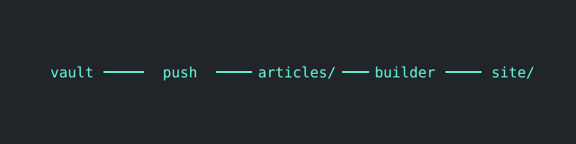

This is a **fixture** for local development and the build tests. Real articles arrive on the
`blog-content` volume from the push process, one folder per post.

## Headings and text

Plain Markdown: *emphasis*, **strong**, `inline code`, and [a link to the other sample](/blog/second-sample-post/).

> A plain blockquote for a pull quote.

> [!NOTE]
> Callouts use the GitHub form. `[!TIP]`, `[!WARNING]` and `[!IMPORTANT]` get their own colour.

> [!WARNING]
> Raw HTML is dropped: the <b>tags</b> are removed and their text stays.

## Images

Images sit next to `index.md` and are referenced relatively:



## Code and tables

```yaml
# blog-content/articles/<slug>/index.md
title: "Waiting Is Not Failing"
published: 2026-11-21
topics: [gitops, flux]
```

| Field | Required | Notes |
|---|---|---|
| title | yes | up to 120 characters |
| description | yes | used in the list, RSS and search results |
| published | yes | YYYY-MM-DD |
| topics | no | lowercase words joined by hyphens |
